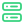
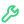
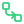
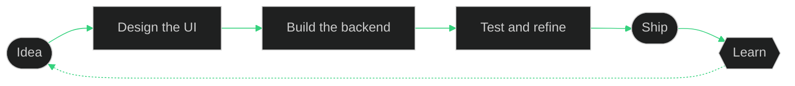
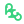
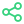

<!-- HEADER -->
<p align="center">
  
</p>

<p align="center">
  
</p>

<p align="center">
  <a href="https://github.com/davidkisoi51-web?tab=followers"></a>
  <a href="https://github.com/davidkisoi51-web?tab=repositories"></a>
  
</p>

<p align="center">
  <em>Building thoughtful interfaces, reliable backends, and applications that scale.</em>
</p>

<p align="center"></p>

<!-- ABOUT -->
##  &nbsp;Who's behind the keyboard

<p align="center">
  
</p>

I'm a developer focused on **full-stack development**, **backend logic**, and building **scalable applications**. I enjoy turning ideas into useful products, learning by shipping, and keeping the details clean from the UI all the way down to the database.

```js
const david = {
  role:       "Full-Stack Developer",
  focus:      ["Backend logic", "Scalable apps", "Clean UI-to-database details"],
  frontend:   ["HTML", "CSS", "JavaScript", "React"],
  backend:    ["Python", "Flask", "Django", "PostgreSQL"],
  tools:      ["Git", "Linux"],
  principle:  "Learn by shipping.",
  currentlyLevelingUp: ["TypeScript", "Docker", "System Design"], // Edit this list
  askMeAbout: ["Building REST APIs", "Database design", "Turning ideas into products"],
  isAlwaysBuilding: true,
};
```

<p align="center"></p>

<!-- TECH STACK -->
##  &nbsp;Tech Stack

<table align="center">
  <tr>
    <td align="center"> <b>Frontend</b></td>
    <td></td>
  </tr>
  <tr>
    <td align="center"> <b>Backend</b></td>
    <td></td>
  </tr>
  <tr>
    <td align="center"> <b>Database</b></td>
    <td></td>
  </tr>
  <tr>
    <td align="center"> <b>Tools</b></td>
    <td></td>
  </tr>
</table>

<details>
<summary><b> &nbsp;On my radar (what I'm leveling up next)</b></summary>
<br />

<p align="center">
  
</p>

<!-- Edit this list to match what you're currently learning. -->

</details>

<p align="center"></p>

<!-- HOW I BUILD -->
##  &nbsp;How I Build



<p align="center"></p>

<!-- STATS -->
##  &nbsp;GitHub at a Glance

<p align="center">
  
  
</p>

<p align="center">
  
</p>

###  Contribution Snake

<p align="center">
  
</p>

<!-- The contribution snake appears after the workflow runs for the first time. -->

<p align="center"></p>

<!-- CONNECT -->
##  &nbsp;Let's Connect

<p align="center">
  <a href="https://github.com/davidkisoi51-web"></a>
  <!-- Uncomment and fill in whichever you use:
  <a href="https://www.linkedin.com/in/YOUR-HANDLE"></a>
  <a href="mailto:you@example.com"></a>
  <a href="https://x.com/YOUR-HANDLE"></a>
  -->
</p>

<p align="center">
  
</p>

<!-- FOOTER -->
<p align="center">
  
</p>
