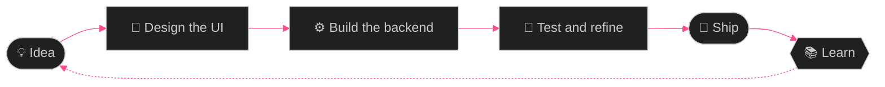

<!-- ═══════════════ HEADER ═══════════════ -->
<p align="center">
  
</p>

<p align="center">
  
</p>

<p align="center">
  <a href="https://github.com/davidkisoi51-web?tab=followers"></a>
  <a href="https://github.com/davidkisoi51-web?tab=repositories"></a>
  
</p>

<p align="center">
  <em>Building thoughtful interfaces, reliable backends, and applications that scale.</em>
</p>

<p align="center"></p>

<!-- ═══════════════ ABOUT ═══════════════ -->
## 🧑‍💻 &nbsp;Who's behind the keyboard

<p align="center">
  
</p>

I'm a developer focused on **full-stack development**, **backend logic**, and building **scalable applications**. I enjoy turning ideas into useful products, learning by shipping, and keeping the details clean from the UI all the way down to the database.

```js
const david = {
  role:       "Full-Stack Developer",
  focus:      ["Backend logic", "Scalable apps", "Clean UI-to-database details"],
  frontend:   ["HTML", "CSS", "JavaScript", "React"],
  backend:    ["Python", "Flask", "Django", "PostgreSQL"],
  tools:      ["Git", "Linux"],
  principle:  "Learn by shipping.",
  currentlyLevelingUp: ["TypeScript", "Docker", "System Design"], // ✏️ edit me
  askMeAbout: ["Building REST APIs", "Database design", "Turning ideas into products"],
  isAlwaysBuilding: true,
};
```

<p align="center"></p>

<!-- ═══════════════ TECH STACK ═══════════════ -->
## ⚡ &nbsp;Tech Stack

<table align="center">
  <tr>
    <td align="center"><b>🎨 Frontend</b></td>
    <td></td>
  </tr>
  <tr>
    <td align="center"><b>⚙️ Backend</b></td>
    <td></td>
  </tr>
  <tr>
    <td align="center"><b>🗄️ Database</b></td>
    <td></td>
  </tr>
  <tr>
    <td align="center"><b>🧰 Tools</b></td>
    <td></td>
  </tr>
</table>

<details>
<summary><b>🔭 &nbsp;On my radar (what I'm leveling up next)</b></summary>
<br />

<p align="center">
  
</p>

<!-- ✏️ Edit this list to match what you're actually learning. -->

</details>

<p align="center"></p>

<!-- ═══════════════ HOW I BUILD ═══════════════ -->
## 🛠️ &nbsp;How I Build



<p align="center"></p>

<!-- ═══════════════ STATS ═══════════════ -->
## 📊 &nbsp;GitHub at a Glance

<p align="center">
  
  
</p>

<p align="center">
  
</p>

### 🏆 Trophies

<p align="center">
  
</p>

### 📈 Contribution Graph

<p align="center">
  
</p>

### 🐍 Contribution Snake

<p align="center">
  
</p>

<!-- 🐍 The snake appears after you add .github/workflows/snake.yml and run it once (see setup notes). -->

<p align="center"></p>

<!-- ═══════════════ CONNECT ═══════════════ -->
## 🤝 &nbsp;Let's Connect

<p align="center">
  <a href="https://github.com/davidkisoi51-web"></a>
  <!-- ✏️ Uncomment and fill in whichever you use:
  <a href="https://www.linkedin.com/in/YOUR-HANDLE"></a>
  <a href="mailto:you@example.com"></a>
  <a href="https://x.com/YOUR-HANDLE"></a>
  -->
</p>

<p align="center">
  
</p>

<!-- ═══════════════ FOOTER ═══════════════ -->
<p align="center">
  
</p>
